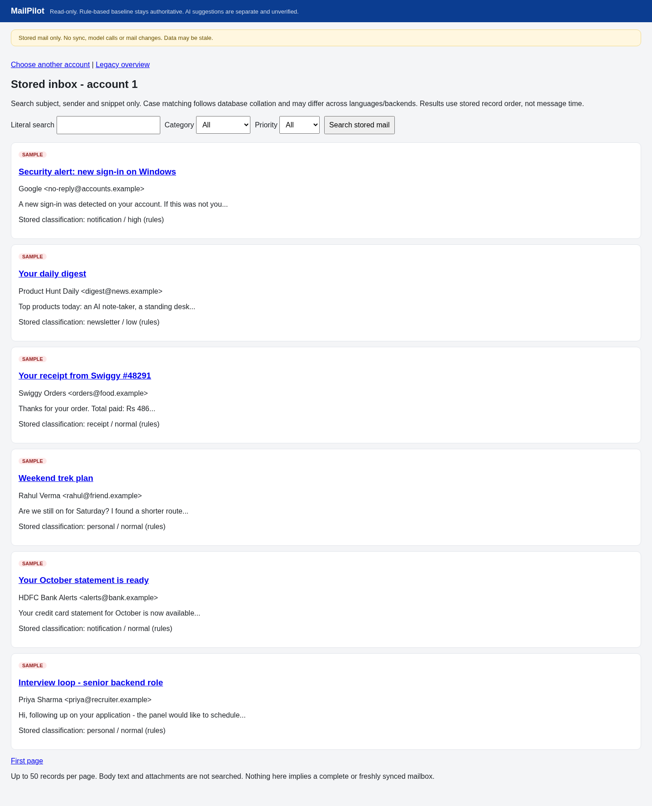

# MailPilot

A read-only email workspace with explainable classification and an experimental, private-model advisory layer.

MailPilot turns stored Gmail messages into a searchable inbox, source-linked thread reviews and a bounded sample briefing. The project explores a practical question: how can an email assistant add useful intelligence without giving a language model control of the mailbox?

**Status:** working local prototype. Hosted access hardening is implemented and tested, but an always-online deployment and a real hosted Google login are still being qualified. No send, delete, label-change or autonomous follow-up feature is enabled.

## What works

| Capability | Current boundary |
| --- | --- |
| Gmail OAuth and ingestion | Read-only scope; encrypted OAuth tokens; message deduplication |
| Stored inbox | Account selector, literal search, category/priority filters, cursor pagination and escaped plain-text detail |
| Explainable classification | Deterministic header/label rules remain authoritative; no model required |
| Thread review | Sample-only extractive highlights and literal request/deadline candidates with source offsets, not inferred commitments |
| Sample briefing | Read-only evidence inventory, with source links and explicit scan limits; no scheduled delivery |
| Private AI suggestions | Default off; explicitly marked synthetic messages only; bounded worker, strict output validation and separate advisory fields |
| Owner access | Loopback-only by default; optional signed owner sessions, exact hosted Host/Origin checks and secure cookies |

## Try it without Google credentials

Python 3.12 on Linux is the tested reference environment. The synthetic demo uses SQLite and makes no Google or model calls.

```bash
python -m venv .venv
source .venv/bin/activate
pip install -r backend/requirements-lock-py312-linux.txt
export DATABASE_URL=sqlite:////tmp/mailpilot-demo.db
export LLM_REFINE=0
python scripts/seed_sample_data.py
cd backend
uvicorn app.main:app --host 127.0.0.1 --port 8000
```

Open `http://127.0.0.1:8000/inbox` or `http://127.0.0.1:8000/dashboard`. All seeded messages carry SAMPLE labels. Use a new database path for a fresh demo; the seed command adds records on each run. Keep the server bound to loopback.



*Screenshot from the local synthetic demo. These are fabricated messages, not a connected inbox.*

## Architecture

```text
Gmail API (read-only OAuth)
          |
          v
FastAPI ingestion -> SQLAlchemy storage -> deterministic classification
          |                                   |
          +----------> stored inbox <---------+
                         |
                         +-> sample thread review / evidence inventory
                         |
                         +-> sample-only job queue -> private model endpoint
                                                       |
                                          validated advisory fields only
```

Python, FastAPI, SQLAlchemy, PostgreSQL for the intended deployment, SQLite for the isolated demo, and server-rendered HTML for the current UI. A separate CLI worker handles optional inference outside HTTP requests. LangGraph and a React frontend are roadmap choices, not installed capabilities.

## Engineering decisions

- **Rules before models.** Model suggestions never overwrite the baseline category or priority and have no mail-action sink.
- **Evidence before claims.** Sample thread candidates link back to exact text; scan limits and omissions are visible. A phrase match is not a verified deadline or accepted task.
- **Fail closed.** Wrong account/message pairs, mixed real/sample review data, invalid model responses and inconsistent hosted configuration are rejected.
- **Bounded inference.** Persisted claims, per-attempt limits, retries/backoff and per-row commits keep slow or interrupted model work separate from ingestion.
- **Honest security boundaries.** OAuth tokens are encrypted, but stored email text is not application-encrypted. Host-level access, TLS and disk safeguards remain deployment requirements.

## Test

```bash
cd backend
pytest -q
```

The hosted-hardening source passed **134 tests, with 2 optional integration tests skipped** in the reference environment. Tests cover ingestion, classification, inbox scoping, source offsets, sample-only gates, worker recovery, strict model parsing and owner-session/Origin/Host boundaries. These are functional tests, not a security audit or a general model-accuracy claim.

A separate disposable Chromium check passed owner login and a cross-site **synthetic** OAuth callback over local HTTPS. It did not contact Google or import real mail.

## Connect Gmail locally

Copy `.env.example` to `.env`, set the database credentials and configure the Google OAuth client, exact callback and token-encryption key. The detailed [engineering notes](docs/ENGINEERING.md#setup) describe the local flow. Use only the `gmail.readonly` scope. Do not commit `.env`, database files, credentials or message content.

Before putting this on the internet, follow [hosted access requirements](docs/HOSTED-ACCESS.md). The source hardening does not make an unconfigured server safe to expose.

## Limitations and next work

- Single-owner application, not a multi-tenant service.
- Real mail can be read in the stored inbox, but AI, thread-review and briefing experiments stay synthetic-only.
- No verified contextual summarisation, automatic replies, drafts, task scheduling or daily briefing delivery.
- Model output can be semantically manipulated even when its JSON is valid. Validation is not factual verification.
- CPU model latency and evidence capacity remain under evaluation. Tiny synthetic examples do not establish production accuracy or RAG suitability.
- Always-online HTTPS deployment, real hosted Google roundtrip and recovery/backup procedures are not complete. A single free VM has no availability guarantee.

[Detailed implementation and limits](docs/ENGINEERING.md) · [Hosted access checklist](docs/HOSTED-ACCESS.md)

## License

MIT. See [LICENSE](LICENSE).
